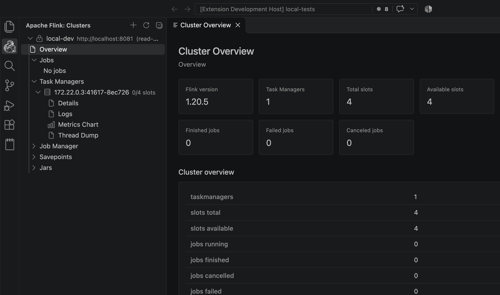

# Apache Flink Manager for VS Code

Manage Apache Flink clusters directly from VS Code. Browse jobs, Task Managers, checkpoints, and JARs, inspect diagnostics in dedicated panels, and run cluster operations without leaving your editor.

## Features

### 🌳 Cluster Explorer
- Manage multiple Flink REST endpoints from one Explorer view
- Add, edit, remove, refresh, and test cluster profiles
- Support local clusters and REST URLs behind a proxy or path prefix
- Store profiles in VS Code global state

### 📊 Cluster and Job Insights
- View Flink version, job counts, Task Managers, and slot availability
- Group jobs by status and inspect job details, execution plans, exceptions, and configuration
- Inspect job status, accumulators, execution results, resource requirements, and rescale history
- Browse checkpoint history, checkpoint details, and vertex subtask data
- Inspect vertex and subtask accumulators, attempts, and aggregated metrics
- Open aggregate job and Task Manager metrics, and view job IDs and statuses
- Open resource-specific panels with summaries and tables instead of raw JSON

### 🧭 Task Manager and JobManager Diagnostics
- Inspect Task Manager details, hardware, slots, logs, and aggregate metrics
- View JobManager configuration, runtime environment, and logs, including per-job log URLs
- Open JobManager and Task Manager thread dumps
- Explore vertex details, backpressure, flamegraphs, watermarks, and subtask timings
- Inspect subtask details and metrics, and retrieve attempt details and accumulators

### ⚙️ Flink Operations
- Cancel jobs, trigger checkpoints and savepoints, stop jobs with savepoints, and rescale jobs
- Upload JARs with the **+** action on the Jars tree item; plan, submit jobs or applications from,
  and delete session-cluster JARs
- Track savepoints created by the extension, restart a job from a tracked savepoint, and request
  asynchronous savepoint disposal
- Update job resource requirements and inspect rescale configuration, history, and summaries
- Follow progress for supported asynchronous operations

### 📈 Metrics
- Browse JobManager, Task Manager, job, and vertex metrics
- Chart numeric metrics with periodic samples
- Pause metric polling when the panel is hidden

## Getting Started

1. Open the **Apache Flink** icon in the VS Code Activity Bar.
2. Select **Add Cluster** and provide a name and Flink REST URL. For a local cluster, use `http://localhost:8081`.
3. Use the cluster's **Test Connection** action to check the REST API and Flink version.
4. Expand the cluster to browse jobs, Task Managers, JobManager resources, savepoints, and JARs.
   Select a resource to open its detail panel, or expand a job, vertex, JAR, or tracked savepoint
   to access its available actions.

Use **Add Cluster** and **Refresh** in the view title. Cluster actions such as edit, remove, and
test connection are available on the cluster tree item. Use **+** beside **Jars** to upload a JAR.
Expand **Savepoints** and then a tracked savepoint to restart a job from it.

## Safety and Compatibility

- Cluster operations are enabled for all profiles. Use a cluster endpoint with appropriate access controls.
- Mutating actions require confirmation; stop-with-savepoint and other disruptive actions use modal confirmation.
- The extension currently supports unauthenticated HTTP/HTTPS Flink REST endpoints. Authentication
  providers and SQL Gateway support are not included.
- Cluster operations are enabled for every profile; access is controlled by the Flink REST endpoint.
- JAR upload, planning, and job submission are intended for session clusters; these endpoints may
  not be available on application-mode clusters.
- For a reverse proxy, include any required path prefix in the cluster REST URL.

## Contributing
### Coming Soon
- Support for Flink SQL Gateway endpoints

## Support

- Report issues on [GitHub](https://github.com/necatiarslan/flink-vscode-extension/issues)
- Check [CHANGELOG.md](CHANGELOG.md) for version history

## Donate
If you find this extension helpful, consider supporting its development through a donation. Your contributions help maintain and improve the extension.
Click [here](https://github.com/sponsors/necatiarslan) to donate. Thank you for your support!
