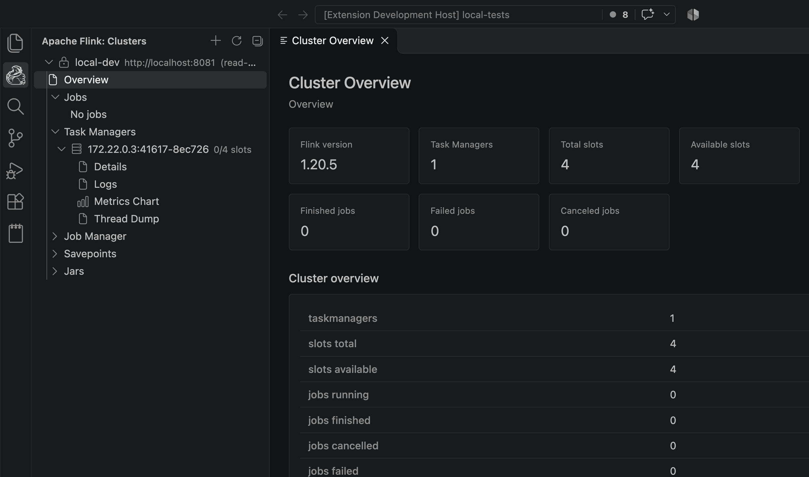

# Apache Flink for VS Code

Manage Apache Flink clusters directly from VS Code. Browse jobs, Task Managers, checkpoints, and JARs, inspect diagnostics in dedicated panels, and run cluster operations without leaving your editor.

## Features

### 🌳 Cluster Explorer
- Manage multiple Flink REST endpoints from one Explorer view
- Add, edit, remove, refresh, and test cluster profiles
- Support local clusters and REST URLs behind a proxy or path prefix
- Store profiles in VS Code global state

### 📊 Cluster and Job Insights
- View Flink version, job counts, Task Managers, and slot availability
- Group jobs by status and inspect job details, execution plans, exceptions, and configuration
- Browse checkpoint history, checkpoint details, and vertex subtask data
- Open resource-specific panels with summaries and tables instead of raw JSON

### 🧭 Task Manager and JobManager Diagnostics
- Inspect Task Manager details, hardware, slots, and logs
- View JobManager configuration, runtime environment, and logs
- Open JobManager and Task Manager thread dumps
- Explore vertex details, backpressure, flamegraphs, watermarks, and subtask timings

### ⚙️ Flink Operations
- Cancel jobs, trigger checkpoints and savepoints, stop jobs with savepoints, and rescale jobs
- Upload, plan, submit, and delete session-cluster JARs
- Track savepoints and request asynchronous savepoint disposal
- Follow progress for supported asynchronous operations

### 📈 Metrics
- Browse JobManager, Task Manager, job, and vertex metrics
- Chart numeric metrics with periodic samples
- Pause metric polling when the panel is hidden

## Getting Started

1. Open the **Apache Flink** icon in the VS Code Activity Bar.
2. Select **Add Cluster** and provide a name and Flink REST URL. For a local cluster, use `http://localhost:8081`.
3. Use the cluster's **Test Connection** action to check the REST API and Flink version.
4. Expand the cluster and select a resource to open its detail panel.

Use the **Add Cluster** and **Refresh** buttons in the view title. Cluster actions such as edit, remove, and test connection are available on the cluster tree item.

## Safety and Compatibility

- New profiles default to **Read-only**. Edit a profile and choose **Allow operations** to enable mutations.
- Existing profiles without an access-mode value remain read-only.
- Mutating actions require confirmation; stop-with-savepoint and other disruptive actions use modal confirmation.
- The extension currently supports unauthenticated HTTP/HTTPS Flink REST endpoints. Authentication providers and SQL Gateway support are not included.
- JAR upload and submission are intended for session clusters; those endpoints may not be available on application-mode clusters.
- For a reverse proxy, include any required path prefix in the cluster REST URL.

## Contributing
### Coming Soon
- Support for Flink SQL Gateway endpoints

## Support

- Report issues on [GitHub](https://github.com/necatiarslan/flink-vscode-extension/issues)
- Check [CHANGELOG.md](CHANGELOG.md) for version history

## Donate
If you find this extension helpful, consider supporting its development through a donation. Your contributions help maintain and improve the extension.
Click [here](https://github.com/sponsors/necatiarslan) to donate. Thank you for your support!
